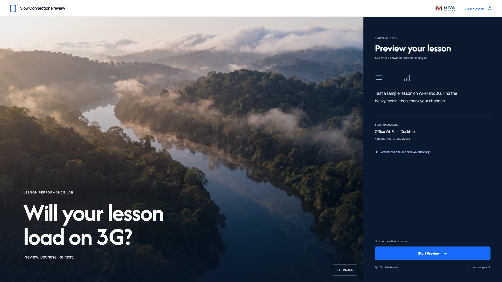

# 01 — Opening



This is a state of the shared `index.html` interface, not another page.

## Layout

The left image introduces the sample lesson; the deck shows starting conditions.

Use `src/styles.css` without redesigning the shell. Reference size: 1920 × 1080. The code also supports 1366 × 768.

## State values

`started=false; connection=wifi; device=desktop; weight=58; all media idle`

These values describe the reference fixture. Normal play derives them from actual interactions.

## Primary action

**Start Preview**

Start Preview creates the Office Wi-Fi baseline run. No prefilled result or score.

## State replication code

From `src/states.js`:

```js
function renderOpeningState(api){return api.opening();}
```

## Relevant shared renderer

From `src/app.js`. Use this inside the provided controller; it relies on the shared model, helpers and state.

```js
function renderOpening(){return `<div class="welcome-content"><div class="welcome-illustration">${icon('desktop')}<span></span>${icon('signal')}</div><p>Test a sample lesson on Wi-Fi and 3G. Find the heavy media, then check your changes.</p><div class="welcome-baseline"><span>Starting conditions</span><strong>Office Wi-Fi <span>·</span> Desktop</strong><small>4 media files · 3 text blocks</small></div></div>`;}
```

## Shared dependencies

- `index.html`: topbar, lesson region, condition controls and deck slots.
- `src/model.js`: media values and timing.
- `src/app.js`: `renderLesson`, `renderFooter`, `runTest`, `finishRun`, `optimise` and `renderMetrics`.
- `src/styles.css`: all spacing, typography, responsive rules and interaction styling.

To inspect this static state, open `index.html?reference=opening` through a local web server or the gallery link. For real play, open `index.html` without a query string.
