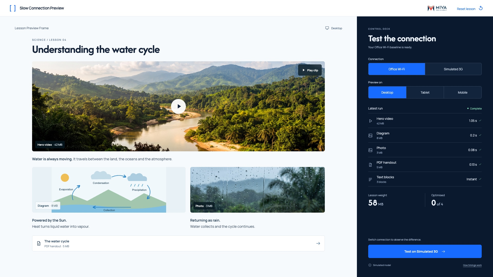

# 02 — Office Wi-Fi baseline



This is a state of the shared `index.html` interface, not another page.

## Layout

The lesson and current run log are fully visible.

Use `src/styles.css` without redesigning the shell. Reference size: 1920 × 1080. The code also supports 1366 × 768.

## State values

`all original sizes; wifi/desktop; complete run; optimised=0`

These values describe the reference fixture. Normal play derives them from actual interactions.

## Primary action

**Test on Simulated 3G**

Switch to 3G to start a fresh run. Selecting media opens its inspector.

## State replication code

From `src/states.js`:

```js
function renderBaselineState(api){return api.log()+api.metrics();}
```

## Relevant shared renderer

From `src/app.js`. Use this inside the provided controller; it relies on the shared model, helpers and state.

```js
function renderLog(compact=false){
  const run=state.run;
  if(!run)return '';
  const changed=state.pending?' · before changes':'';
  const rows=`<div class="log-rows">${run.elements.map(el=>`<button class="log-row ${state.selected===el.id?'active':''}" data-inspect="${el.id}" aria-label="Inspect ${esc(el.name)} from latest run"><span class="log-icon">${icon(M.MEDIA.find(m=>m.id===el.id).icon)}</span><span class="log-name">${esc(el.name)}<small>${M.formatMB(el.size)} MB</small></span><span class="log-status ${el.status}">${el.status==='loading'?'<span class="small-spinner"></span> Loading':M.formatTime(el.delay)+' '+icon('check')}</span></button>`).join('')}<div class="log-row text-log"><span class="log-icon">${icon('text')}</span><span class="log-name">Text blocks<small>3 blocks</small></span><span class="log-status loaded">Instant ${icon('check')}</span></div></div>`;
  const status=`<span class="run-status ${run.complete?'done':''}"><i></i>${run.complete?'Complete':'Loading'}</span>`;
  return compact?`<details class="compact-log"><summary>Latest run${changed}${status}</summary>${rows}</details>`:`<section class="log-section"><div class="section-label"><span>Latest run${changed}</span>${status}</div>${rows}</section>`;
}
```

## Shared dependencies

- `index.html`: topbar, lesson region, condition controls and deck slots.
- `src/model.js`: media values and timing.
- `src/app.js`: `renderLesson`, `renderFooter`, `runTest`, `finishRun`, `optimise` and `renderMetrics`.
- `src/styles.css`: all spacing, typography, responsive rules and interaction styling.

To inspect this static state, open `index.html?reference=baseline` through a local web server or the gallery link. For real play, open `index.html` without a query string.
