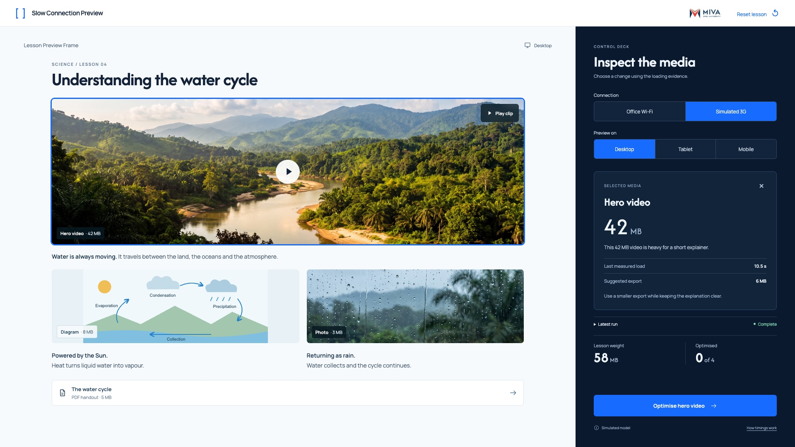

# 04 — Inspect a media file



This is a state of the shared `index.html` interface, not another page.

## Layout

One compact inspector replaces the expanded log. The selected preview object is outlined blue.

Use `src/styles.css` without redesigning the shell. Reference size: 1920 × 1080. The code also supports 1366 × 768.

## State values

`selected=video; observed3g=true; video=42MB; prior 3G timing=10.5s`

These values describe the reference fixture. Normal play derives them from actual interactions.

## Primary action

**Optimise hero video**

Optimise sets the authored reduction and pending state. It does not begin a new run.

## State replication code

From `src/states.js`:

```js
function renderDiagnoseState(api){return api.inspection()+api.log(true)+api.metrics();}
```

## Relevant shared renderer

From `src/app.js`. Use this inside the provided controller; it relies on the shared model, helpers and state.

```js
function renderInspection(){
  const media=state.media.find(m=>m.id===state.selected);
  if(!media)return '';
  const timing=state.run?.elements.find(e=>e.id===media.id);
  return `<section class="inspection"><div class="inspection-top"><span class="selection-label">SELECTED MEDIA</span><button class="icon-button" data-action="close-inspection" aria-label="Close media inspection">×</button></div><h3 id="inspection-title" tabindex="-1">${esc(media.name)}</h3><div class="inspection-size">${M.formatMB(media.size)}<span> MB</span></div><p>${esc(media.optimised?media.approach:media.note)}</p><div class="detail-pair"><span>Last measured load</span><strong>${timing?.status==='loaded'?M.formatTime(timing.delay):'Loading…'}</strong></div><div class="detail-pair"><span>${media.optimised?'Current size':'Suggested export'}</span><strong>${M.formatMB(media.target)} MB</strong></div><small class="clarity-note">${esc(media.approach)}</small></section>`;
}
```

## Shared dependencies

- `index.html`: topbar, lesson region, condition controls and deck slots.
- `src/model.js`: media values and timing.
- `src/app.js`: `renderLesson`, `renderFooter`, `runTest`, `finishRun`, `optimise` and `renderMetrics`.
- `src/styles.css`: all spacing, typography, responsive rules and interaction styling.

To inspect this static state, open `index.html?reference=diagnose` through a local web server or the gallery link. For real play, open `index.html` without a query string.
