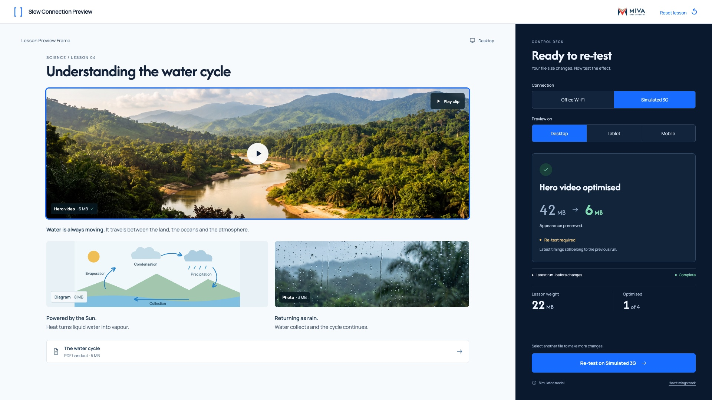

# 05 — Optimised; re-test required



This is a state of the shared `index.html` interface, not another page.

## Layout

Display 42 → 6 MB with the image unchanged and earlier timings preserved.

Use `src/styles.css` without redesigning the shell. Reference size: 1920 × 1080. The code also supports 1366 × 768.

## State values

`video=6MB; total=22MB; optimised=1; pending=true`

These values describe the reference fixture. Normal play derives them from actual interactions.

## Primary action

**Re-test on Simulated 3G**

Choose more media or explicitly re-test. Connection-triggered runs cannot clear pending.

## State replication code

From `src/states.js`:

```js
function renderPendingState(api){return api.pending()+api.log(true)+api.metrics();}
```

## Relevant shared renderer

From `src/app.js`. Use this inside the provided controller; it relies on the shared model, helpers and state.

```js
function renderPending(){
  const change=state.traces[state.traces.length-1];
  const selected=state.media.find(m=>m.id===state.selected);
  if(selected && !selected.optimised)return renderInspection()+`<div class="pending-inline">Re-test required for saved changes</div>`;
  return `<section class="change-confirmation"><span class="soft-check">${icon('check')}</span><h3>${esc(change.name)} optimised</h3><div class="size-change"><span>${M.formatMB(change.before)}<small> MB</small></span>${icon('arrow')}<strong>${M.formatMB(change.after)}<small> MB</small></strong></div><p>Appearance preserved.</p><div class="pending-inline"><span class="amber-dot"></span>Re-test required</div><small>Latest timings still belong to the previous run.</small></section>`;
}
```

## Shared dependencies

- `index.html`: topbar, lesson region, condition controls and deck slots.
- `src/model.js`: media values and timing.
- `src/app.js`: `renderLesson`, `renderFooter`, `runTest`, `finishRun`, `optimise` and `renderMetrics`.
- `src/styles.css`: all spacing, typography, responsive rules and interaction styling.

To inspect this static state, open `index.html?reference=pending` through a local web server or the gallery link. For real play, open `index.html` without a query string.
