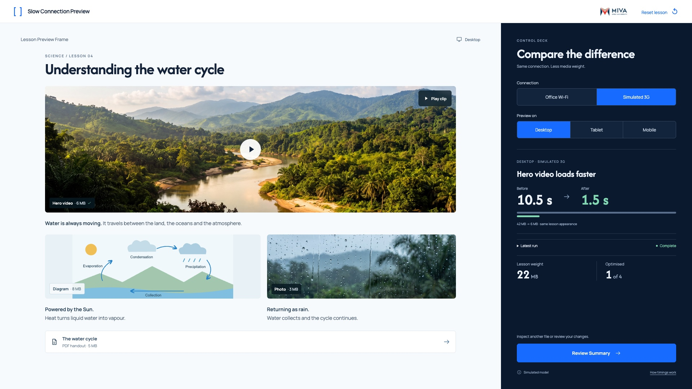

# 06 — Compare the re-test



This is a state of the shared `index.html` interface, not another page.

## Layout

Compare the video within matching Desktop + 3G runs. Other element timings remain expandable.

Use `src/styles.css` without redesigning the shell. Reference size: 1920 × 1080. The code also supports 1366 × 768.

## State values

`before video=42MB/10.5s; after=6MB/1.5s; pending=false; verifiedRevision=1`

These values describe the reference fixture. Normal play derives them from actual interactions.

## Primary action

**Review Summary**

Review Summary opens the descriptive ending in the same deck.

## State replication code

From `src/states.js`:

```js
function renderCompareState(api){return api.comparison()+api.log(true)+api.metrics();}
```

## Relevant shared renderer

From `src/app.js`. Use this inside the provided controller; it relies on the shared model, helpers and state.

```js
function renderComparison(){
  const c=state.comparison;
  if(!c)return '';
  if(!c.before)return `<section class="comparison"><span class="selection-label">RE-TEST COMPLETE</span><h3>${deviceName(c.after.device)} · ${networkName(c.after.connection)}</h3><p>No matching original run was recorded for this device. The latest timings are shown below.</p></section>`;
  const changed=c.after.elements.filter(el=>el.size<c.before.elements.find(b=>b.id===el.id).size);
  const chosen=changed.find(e=>e.id==='video')||changed[0];
  const before=c.before.elements.find(e=>e.id===chosen.id);
  return `<section class="comparison"><span class="selection-label">${deviceName(c.after.device).toUpperCase()} · SIMULATED 3G</span><h3>${esc(chosen.name)} loads faster</h3><div class="time-comparison"><div><span>Before</span><strong>${M.formatTime(before.delay)}</strong></div>${icon('arrow')}<div><span>After</span><strong class="mint">${M.formatTime(chosen.delay)}</strong></div></div><div class="load-bars" aria-hidden="true"><i style="width:100%"></i><i style="width:${Math.max(2,chosen.delay/before.delay*100)}%"></i></div><small>${M.formatMB(before.size)} MB → ${M.formatMB(chosen.size)} MB · same lesson appearance</small></section>`;
}
```

## Shared dependencies

- `index.html`: topbar, lesson region, condition controls and deck slots.
- `src/model.js`: media values and timing.
- `src/app.js`: `renderLesson`, `renderFooter`, `runTest`, `finishRun`, `optimise` and `renderMetrics`.
- `src/styles.css`: all spacing, typography, responsive rules and interaction styling.

To inspect this static state, open `index.html?reference=compare` through a local web server or the gallery link. For real play, open `index.html` without a query string.
