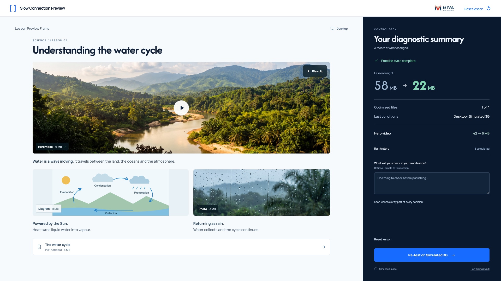

# 07 — Review and transfer



This is a state of the shared `index.html` interface, not another page.

## Layout

Show weight, changes, selected conditions and optional private reflection beside the same lesson.

Use `src/styles.css` without redesigning the shell. Reference size: 1920 × 1080. The code also supports 1366 × 768.

## State values

`panel=summary; total=22MB; optimised=1; completed cycle`

These values describe the reference fixture. Normal play derives them from actual interactions.

## Primary action

**Re-test on Simulated 3G**

Reflection is optional and session-only. Re-test again or reset without a confirmation.

## State replication code

From `src/states.js`:

```js
function renderSummaryState(api){return api.summary();}
```

## Relevant shared renderer

From `src/app.js`. Use this inside the provided controller; it relies on the shared model, helpers and state.

```js
function renderSummary(){
  const latest=state.history[state.history.length-1];
  return `<section class="summary"><div class="summary-status">${icon('check')} Practice cycle complete</div><div class="summary-weight"><span>Lesson weight</span><div><span>58<small> MB</small></span>${icon('arrow')}<strong>${M.formatMB(M.weight(state))}<small> MB</small></strong></div></div><div class="summary-facts"><span>Optimised files<strong>${state.media.filter(m=>m.optimised).length} of 4</strong></span><span>Last conditions<strong>${deviceName(latest.device)} · ${networkName(latest.connection)}</strong></span></div><div class="summary-changes">${state.traces.map(t=>`<div><span>${esc(t.name)}</span><strong>${M.formatMB(t.before)} → ${M.formatMB(t.after)} MB</strong></div>`).join('')}</div><details class="history"><summary>Run history <span>${state.history.length} completed</span></summary><ol>${state.history.map(r=>`<li><strong>${networkName(r.connection)} · ${deviceName(r.device)}</strong><span>${M.formatMB(r.total)} MB · ${r.intent==='retest'?'Deliberate re-test':'Condition run'}</span><small>${r.elements.map(e=>`${e.name}: ${M.formatTime(e.delay)}`).join(' · ')}</small></li>`).join('')}</ol></details><label class="reflection-label" for="reflection">What will you check in your own lesson?<span>Optional · private to this session</span></label><textarea id="reflection" maxlength="400" rows="2" placeholder="One thing to check before publishing…">${esc(state.reflection)}</textarea><p class="summary-reminder">Keep lesson clarity part of every decision.</p></section>`;
}
```

## Shared dependencies

- `index.html`: topbar, lesson region, condition controls and deck slots.
- `src/model.js`: media values and timing.
- `src/app.js`: `renderLesson`, `renderFooter`, `runTest`, `finishRun`, `optimise` and `renderMetrics`.
- `src/styles.css`: all spacing, typography, responsive rules and interaction styling.

To inspect this static state, open `index.html?reference=summary` through a local web server or the gallery link. For real play, open `index.html` without a query string.
